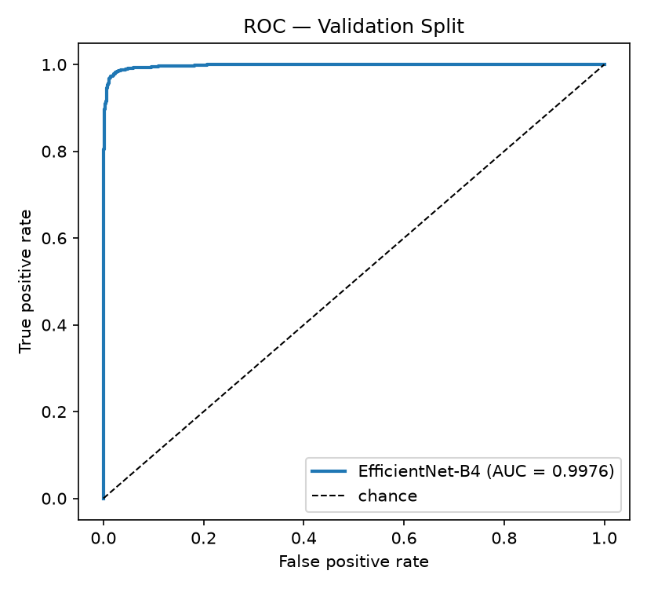

# VeraLens

This repository was developed as a bachelor thesis project (2026). It implements an
explainable deepfake photo detector that runs entirely on a consumer laptop: a fine-tuned
visual classifier decides whether a face is fake, and a small local vision-language model
explains that decision in plain words.

**Explainable deepfake detection for face photos.**
Runs locally on a **GTX 1650 (4GB VRAM)**. An **EfficientNet-B4** classifier gives a Fake
Probability and a **Grad-CAM Saliency Map**; **Qwen3-VL-2B-Instruct** (4-bit) reads the same
Face Crop and writes a structured explanation; **Fusion** combines both into one Verdict.
No external API is called while serving a request.



<!-- TODO: add app screenshots/GIFs under docs/demo/ (upload → face picker → verdict). -->

> **VeraLens can make mistakes.** It was 97.5% accurate on 2,799 test faces but hasn't been
> tested on everyday photos. The explanation does not make the result more reliable.

The thesis contribution is the **integration architecture, the Fusion layer and the
explainability pipeline**, not the visual backbone.

## Features

* **Upload or camera**: submit a photo from a file or take one with the camera.
* **Face picker**: when a photo has several faces, InsightFace finds them all and you pick
  one. Choosing costs nothing, because nothing has been analysed yet (ADR 0012).
* **Crop and rotate**: straighten a sideways or small face before sending it.
* **Saliency Map**: a Grad-CAM overlay shows which regions drove the classifier.
* **Plain or Technical explanation**: Plain is what the reasoning layer said in its own
  words; Technical shows every measurement behind the Verdict (ADR 0010).
* **Draws**: the reasoning layer samples, so you can ask it again and see how much the
  explanation changes. The Verdict stays the one from the first Draw (ADR 0013).
* **Compare two**: hold one Analysis and read a second next to it on one shared scale.
* **Batch**: up to 20 photos, analysed one at a time, with a CSV export. A Batch is a
  queue, not an accuracy measurement.
* **Step-by-step progress**: the waiting screen shows which step is running, not a fake
  percentage (ADR 0015).
* **Phone layout and dark theme.**

## Quick Start

1. **Install Python 3.13**, then create the environment.

    * Install **PyTorch first**, from the CUDA 12.4 index. Otherwise pip picks CPU wheels
      and the whole pipeline runs on the CPU without saying so:
      ```bash
      python -m venv venv && source venv/Scripts/activate   # Windows Git Bash
      pip install torch torchvision --index-url https://download.pytorch.org/whl/cu124
      pip install -r requirements.txt
      cp .env.example .env
      ```

2. **Add the classifier checkpoint.**

    * Put `effnb4_deepfake.pt` at `backend/models/effnb4_deepfake.pt`. It is git-ignored.
    * Without it the classifier **silently falls back to ImageNet weights** and every
      Verdict is noise. Check the line it prints at startup.

3. **Start the backend.**
    ```bash
    uvicorn backend.app.api.main:app --reload      # http://localhost:8000
    ```
    Verify in your browser: `http://localhost:8000/health` should answer `200`.

4. **Start the frontend.**
    ```bash
    cd frontend && npm install && npm run dev      # http://localhost:5173
    ```

5. **Submit a photo** → pick a face if there is more than one → wait for the Analysis
   (about a minute) → read the Verdict, the Saliency Map and the explanation.

Prefer Docker? Run the whole thing with:
```bash
docker compose up --build      # first build: 20–40 min, several GB
```
Compose bind-mounts the checkpoint, the HuggingFace cache (Qwen3-VL is ~4GB) and the
InsightFace cache (~300MB) instead of baking them into the image.

To serve it publicly from this laptop, see [`DEPLOY.md`](DEPLOY.md).

## API endpoints

| Endpoint | What it does |
|---|---|
| `GET /health` | Dependency-free liveness probe (keep-alive cron pings it every 10 min) |
| `POST /detect` | Upload → `{token, faces[]}`, or `{"faces": []}` when none are found |
| `POST /analyze` | `token` + `face_index` → 202 at once; the Analysis runs on a background thread (ADR 0016) |
| `GET /result/{token}` | 202 while running, the full Analysis when done, 500 if it failed, 404 unknown/expired |
| `GET /progress/{token}` | Which step the Analysis is on (ADR 0015) |
| `/static/heatmaps/…` | Generated Saliency Map overlays |
| `/` | The built frontend (`frontend/dist`), when it exists |

## Scripts

All of these are offline batch work. **None of them is on the inference path.**

| Command | What it does |
|---|---|
| `python scripts/evaluate.py` | 4.1 Detection Metrics |
| `python scripts/evaluate_ablation.py` | 4.2 Ablation Arms: Vision-Only / LLM-Only / Fused |
| `python scripts/evaluate_explanations.py` | 4.3 Explanation Quality: ROUGE + diversity |
| `python scripts/run_judge_eval.py` | 4.4 Explanation Quality: LLM-as-judge |
| `python scripts/compare_informed.py` | Blind vs production explanations |
| `python scripts/report_results.py` | Regenerates `results/RESULTS.md` |
| `python scripts/export_showcase.py` | Builds the static, GPU-free demo under `showcase/` |
| `python scripts/keepalive.py` | Pings `/health` for a deployed demo |
| `python scripts/backup_judge_scores.py` | Backs up the judge score table |

**Tests and linting:**
```bash
pytest                       # backend
cd frontend && npm test      # Vitest
cd frontend && npm run lint  # oxlint
```

## Settings

Environment only, in `.env` (see `.env.example`). Nothing reads a committed config file,
and no default is ever a real key.

| Variable | Default | Notes |
|---|---|---|
| `JUDGE_PROVIDER` | `gemini` | `local` runs the on-device Qwen judge; no data leaves the machine |
| `GEMINI_API_KEY` | — | Required for `gemini`. Prepaid; a full 563-explanation run is about $1–2 (ADR 0014) |
| `JUDGE_MODEL` | `gemini-3.8-flash` | The exact resolved version is recorded on every score row |
| `JUDGE_RPM` / `JUDGE_DAILY_QUOTA` | `10` / `250` | Client-side throttle (free-tier defaults; the paid Gemini run used `30` / `800`). Backoff alone will not save a batch run |
| `DATABASE_URL` | SQLite `data/judge.db` | Dev fallback. Final results belong in Neon/Supabase |
| `VERALENS_FACE_DEVICE` | `cpu` | `cuda` is 0.2 s faster but holds ~805 MiB for the process lifetime (ADR 0011) |
| `VERALENS_PUBLIC` | unset | `1` disables `/docs`, `/redoc`, `/openapi.json` (see `DEPLOY.md`) |
| `VERALENS_MAX_ACTIVE` | `4` | Analyses running or queued; past it, `/analyze` answers 429 |
| `VERALENS_MAX_UPLOAD_MB` | `20` | Larger Submitted Photos are refused with 413 |

## Why the reasoning layer? (what the evidence supports)

The reasoning layer **does not make detection more accurate**. It makes the Verdict
**understandable**.

| Detection Metrics (Leakage-Free Subset, 2,799 images) | Value |
|---|---|
| Accuracy | 0.9750 |
| AUC-ROC | 0.9973 |
| Macro F1 | 0.9750 |

* **Detection: no significant gain.** The three-arm ablation (400 images, reasoning layer
  run blind) gives Vision-Only 0.9775, LLM-Only 0.6625, Fused 0.9825. The fused gain rests
  on four discordant images (McNemar exact p = 0.6250), and AUC moves the other way. Fusion
  is not claimed to improve detection (ADR 0005).
* **Explanation Quality: a real gain.** When the reasoning layer is told what the classifier
  found, in words rather than as a number (ADR 0008), it explains fakes significantly
  better: +0.91 judge points on the local judge (sign test p = 0.0015), and +0.68 on the
  independent Gemini 3.8 Flash judge (p < 0.0001, ADR 0014). This is the thesis's actual
  claim.

The two judges are reported separately and never pooled: the local judge grades its own
author, so cite it as an optimistic bound (ADR 0007). Full tables and limitations:
[`results/RESULTS.md`](results/RESULTS.md).

## How it works (high level)

```
Submitted Photo
  ├─ POST /detect   → InsightFace: every face, boxes + scores (CPU, ~0.2 s)
  │                   └─ the browser picks one when there is more than one
  └─ POST /analyze (token + face_index) → 202    ── under a single GPU lock ──
        EfficientNet-B4 (fine-tuned) ─► Fake Probability
        Grad-CAM                     ─► Saliency Map (PNG under /static)
        unload classifier + CAM      ─► frees VRAM before the VLM loads
        Qwen3-VL-2B-Instruct (4-bit) ─► verdict, confidence, signals, explanation
        Fusion 0.55·vision + 0.45·llm ─► final Verdict + Fake Probability
     browser polls GET /progress (1 s) and GET /result (2 s) until done
```

1. **Detect**: InsightFace finds every Face Candidate. You pick one, and it becomes the
   224×224 Face Crop, the only input the classifier ever sees.
2. **Classify**: EfficientNet-B4 gives a Fake Probability, and Grad-CAM draws the Saliency
   Map. Both are then unloaded, because the two models **never fit on the GPU together**.
3. **Explain**: Qwen3-VL-2B reads the Face Crop and the classifier's Verdict, stated in
   words, and returns structured JSON with signals and an explanation.
4. **Fuse**: `0.55 · vision + 0.45 · llm`. If the reply can't be parsed, the classifier's
   result is used alone and `explanation_available` is `false`. It never falls back to a
   0.0 that would read as "certainly real".

One Analysis runs at a time (`threading.Lock`). It takes **60 s at the median**, 40 s at
the floor and 169 s at p90 (n=600, `results/ablation_records*.jsonl`).

## Requirements

* **GPU:** NVIDIA with 4GB VRAM or more (built and measured on a GTX 1650)
* **RAM:** 16GB
* **Python** 3.13, **PyTorch** with the CUDA 12.4 wheel
* **Node.js** for the frontend (React 19, Vite 8, Tailwind v4)
* Optional: **Docker / Docker Compose**

## Dataset

`pujanpaudel/deepfake_face_classification` (Hugging Face, CC BY-NC 4.0, derived from the
DF40 benchmark). **32,120 images, balanced 16,060 / 16,060**, laid out as
`data/deepfake_faces/real/` (label 0) and `data/deepfake_faces/fake/` (label 1).
Photo-only; video is out of scope.

* **No held-out test set exists.** Only a 90/10 train/validation split was ever made, and
  the validation data informed training. Everything reported is Validation Performance
  (ADR 0001).
* **413 of 3,212 validation images (12.86%) are byte-identical to a training image.**
  Headline metrics use the Leakage-Free Subset of 2,799 (ADR 0004).

> `scripts/download_dataset.py` is **stale** and will not reproduce that layout. It calls
> `load_from_disk("data/celebdf")` and uses the opposite label convention (1 = real).
> Treat it as a historical artefact, not as setup instructions.

## Privacy

* The inference path runs locally. No external API is called while serving a request.
* Submitted Photos are kept in the temp directory only until their Analysis finishes, or
  for 15 minutes if never analysed, then deleted.
* Saliency Maps stay in `backend/static/heatmaps/` until deleted by hand.
* A Held Analysis lives only in the browser tab and is never stored.
* The Gemini judge is **evaluation-only**. It grades stored explanations in batch jobs and
  never sees a live request.

## Troubleshooting

* **Everything is slow / runs on the CPU**

  * PyTorch was installed from the default index. Reinstall it from the CUDA 12.4 index
    (Quick Start step 1).

* **`CUDAExecutionProvider` missing / face detection on the CPU unexpectedly**

  * Keep `onnxruntime-gpu==1.22.0`. Versions 1.23+ are built against CUDA 13 and fall back
    to CPU silently (ADR 0011).
  * Never also install `onnxruntime`. Both write the same package directory and the CPU
    build wins: `pip uninstall onnxruntime onnxruntime-gpu`, then reinstall
    `requirements.txt`.

* **Every Verdict looks random**

  * The checkpoint is missing and the classifier fell back to ImageNet weights. Check
    `backend/models/effnb4_deepfake.pt` and the startup line.

* **"No face found"**

  * That is not a Verdict of REAL; the pipeline never ran. Use a clear, front-facing photo,
    or crop and rotate it first.

* **The explanation changed when I asked again**

  * Expected. The reasoning layer samples (ADR 0013); each Draw can word things differently.

* **`429` from `/analyze`**

  * Too many Analyses running or queued. Wait, or raise `VERALENS_MAX_ACTIVE`.

## Scope

Photo-only, by decision. No video, no FFmpeg, no temporal analysis . Document OCR, MRZ parsing and face-comparison identity verification belong to the shelved VeraID concept and are recorded as future work.

## Where to read next

* [`CONTEXT.md`](CONTEXT.md): the domain vocabulary. Terms here are load-bearing; each
  entry also lists the words **not** to use.
* [`docs/adr/`](docs/adr/): 16 decision records. Read 0001, 0004 and 0005 before quoting
  any number, and 0011 before changing anything about device placement.
* `../Veralens Info.md`: the full current-state project snapshot.
* [`showcase/README.md`](showcase/README.md): publishing the static demo.
* [`DEPLOY.md`](DEPLOY.md): serving the live app from this laptop through a Cloudflare Tunnel.

## License

Not decided yet. Until it is, all rights are reserved.

## Third-party models and data

VeraLens uses third-party models and data, each under its own license: the dataset
(CC BY-NC 4.0, non-commercial), Qwen3-VL-2B-Instruct, the InsightFace `buffalo_l` models,
and the `timm` EfficientNet-B4 backbone. Check each upstream license before any reuse
beyond this thesis.
