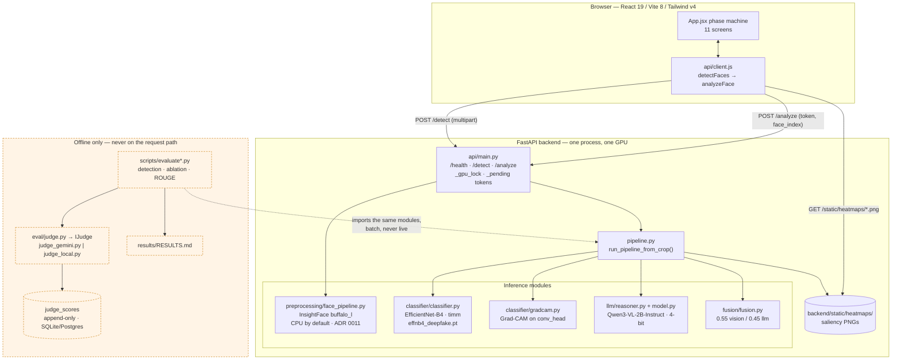
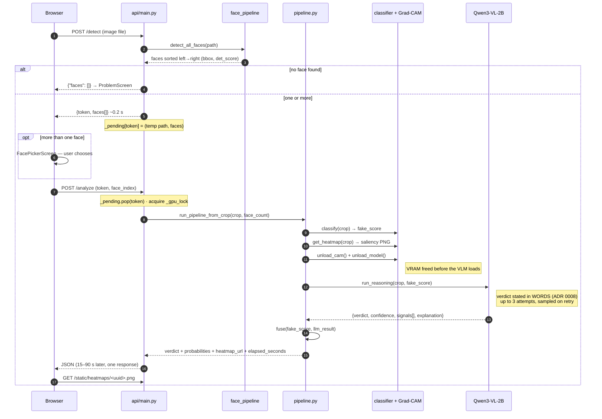
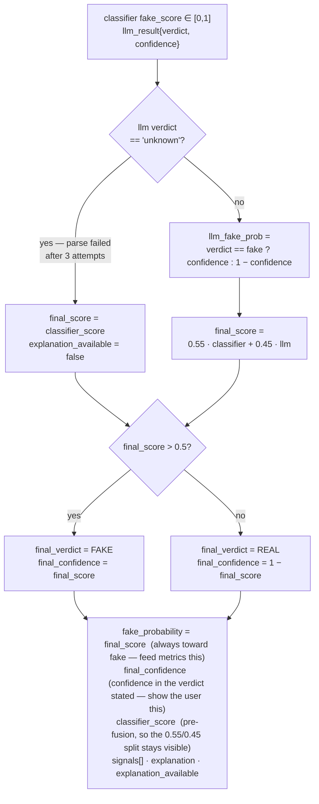
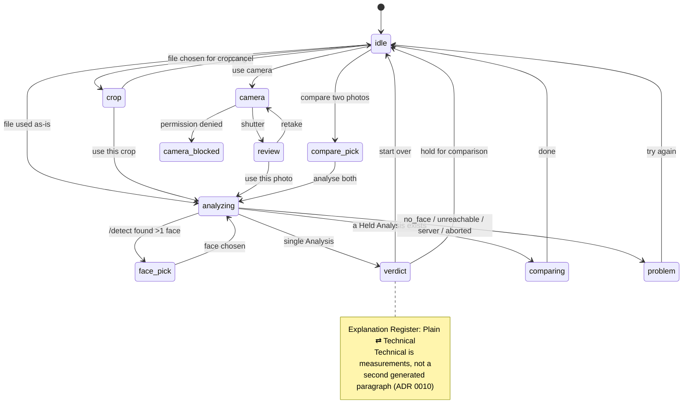
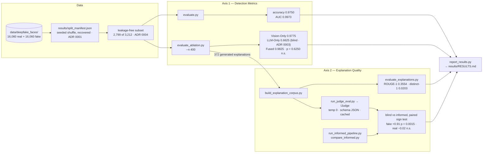

# VeraLens — Architecture Diagrams

Drawn from the code on 23 September 2026. Every box names a real module, and every
number (224×224, 4-bit, 0.55/0.45, 805 MiB, 15–90 s) is taken from the source or from
`results/RESULTS.md` rather than estimated. Terms follow [`../CONTEXT.md`](../CONTEXT.md).

Diagrams are Mermaid, so they render on GitHub and can be exported to SVG/PNG for the
thesis. If any of these stops matching the code, fix the code or fix the diagram — do not
leave both.

---

## 1. System overview

The inference path is entirely local. The judge is drawn deliberately **outside** it: it
never runs while a request is being served (ADR 0007, and the "evaluation-only" rule in
CLAUDE.md).

---

## 2. One analysis, end to end

Two requests, not one. Detection is cheap (~0.2 s on the CPU default) and has to answer
before anything slow starts, because the picker needs the box list. The token carries the
uploaded file across to the second request.

`/analyze` is a plain `def`, not `async def`, so Starlette runs it in the threadpool and
`/health` keeps answering while an analysis blocks for a minute.

---

## 3. The VRAM handoff

The reason the pipeline is shaped the way it is. 4096 MiB total; the two models are never
resident together.

```mermaid
gantt
    title GPU residency during one analysis (GTX 1650, 4 GB)
    dateFormat X
    axisFormat %s

    section Face detection
    InsightFace on CPU by default (CUDA would hold 805 MiB for the process lifetime)  :done, det, 0, 1

    section Classifier
    EfficientNet-B4 loaded          :active, cls, 1, 3
    Grad-CAM over the same weights  :active, cam, 2, 3
    unload_cam() + unload_model()   :crit, free, 3, 4

    section Reasoning
    Qwen3-VL-2B loaded 4-bit        :active, llm, 4, 9

    section Fusion
    Arithmetic only, no GPU         :fus, 9, 10
```

Grad-CAM **must** run before the unload: it needs the classifier's loaded weights. A
`threading.Lock` around the whole span keeps two requests from unloading a model out from
under each other.

---

## 4. Fusion logic

Three details that exist because their absence was a bug: the `unknown` branch (a failed
parse has `confidence = 0.0`, which would otherwise compute to a 1.0 fake probability),
the split between `fake_probability` and `final_confidence` (a REAL verdict at 0.18 read
as "REAL (18.0%)"), and surfacing `classifier_score`.

> **Measured caveat.** This layer does *not* improve detection: +0.0050 accuracy over
> Vision-Only on four discordant images, McNemar p = 0.6250, AUC moving the other way
> (ADR 0005). It is in the system because the explanation needs a single number to
> account for, not because it detects better.

---

## 5. Frontend phase machine

`App.jsx` holds one `phase` string; each screen is a render branch off it.

---

## 6. Offline evaluation

Two independent axes that share no code, no data and no metrics — never call either one
"the evaluation" without qualifying it.

The judge that produced the reported scores was the **on-device** implementation — the
same Qwen3-VL-2B weights that wrote the explanations, because no `GEMINI_API_KEY` was
configured. Treat its absolute means as an optimistic bound (ADR 0007); the paired
blind-vs-informed difference is the trustworthy part, since one judge grades both arms.

---

## Where the numbers come from

| Figure in these diagrams | Source |
|---|---|
| 224×224 crop, buffalo_l, det_size 640 | `backend/app/preprocessing/face_pipeline.py` |
| 805 MiB CUDA provider cost, CPU default | `.env.example`, ADR 0011 |
| 0.55 / 0.45 weights, field semantics | `backend/app/fusion/fusion.py` |
| 3 attempts, 512 new tokens, sampling on retry | `backend/app/llm/reasoner.py` |
| 15–90 s, `elapsed_seconds`, `faces_found` | `backend/app/pipeline.py` |
| Accuracy, AUC, ablation, ROUGE, judge means | `results/RESULTS.md` |
