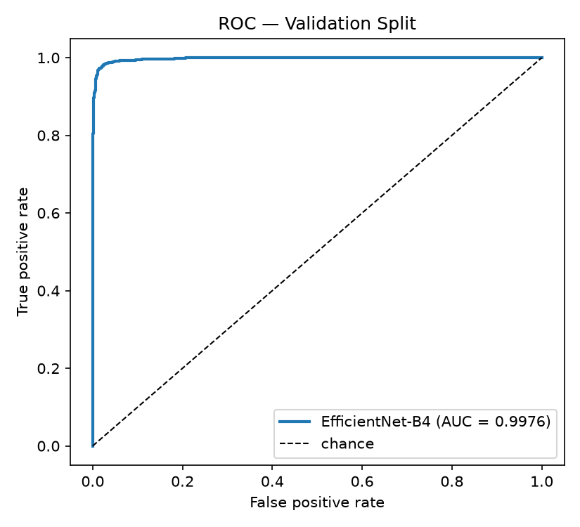
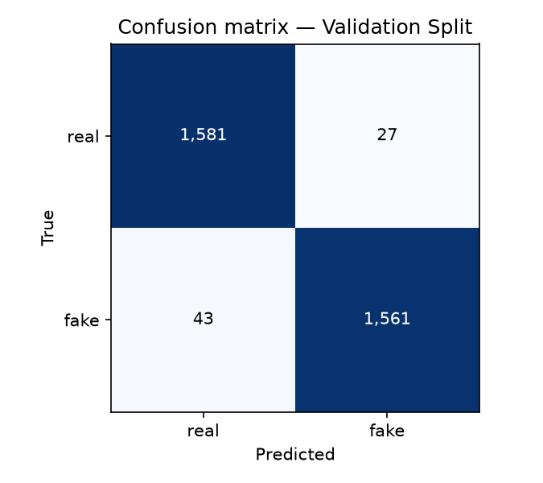

# VeraLens — Results

Generated by `scripts/report_results.py`. Numbers come from
`scripts/evaluate.py` (detection) and `scripts/evaluate_ablation.py`
(ablation). See `docs/adr/0001`, `0003` and `0004` for methodology.

## What was measured, and on what

These are **Validation Performance** figures, not test performance:
`build_splits()` only ever produced a train/validation pair, and that
validation data was observed while training (it informed the two-phase
schedule). No untouched test set exists. Model selection was never
automated against it — training saves the final epoch rather than the
best-validation checkpoint — so the contamination is weak, but the
distinction belongs in the write-up.

The dataset also contains duplicate images, and the split shuffles
rather than deduplicates, so **413 of 3,212 validation images (12.86%)** are byte-identical to a training
image. Headline figures below exclude them.

## Detection Metrics — leakage-free subset

| Metric | Value |
| --- | --- |
| Accuracy | 0.9750 |
| AUC-ROC | 0.9973 |
| Macro F1 | 0.9750 |
| Images | 2,799 |

| Class | Precision | Recall | F1 | Support |
| --- | --- | --- | --- | --- |
| real | 0.9696 | 0.9807 | 0.9751 | 1,399 |
| fake | 0.9805 | 0.9693 | 0.9749 | 1,400 |

| | predicted real | predicted fake |
| --- | --- | --- |
| **true real** | 1,372 | 27 |
| **true fake** | 43 | 1,357 |

For comparison, on the full validation split including the 413 leaked images: accuracy 0.9782, AUC 0.9976. The +0.0032 difference is the inflation contributed by leakage.

### Split recovery

The 4 August training run saved no metrics. Its split was regenerated
by re-running the seeded shuffle, which reproduced the recorded figures
exactly — accuracy 0.9782 against a recorded 0.9782, AUC 0.9976 against 0.9976. This confirms both the recovery and the
originally reported numbers.

## Ablation — does the reasoning layer add detection value?

400 images, stratified and shuffled, drawn from the
leakage-free validation pool. The reasoning layer ran **blind** —
production shows it the classifier's score, which would make an
"LLM-only" arm circular and cause fusion to double-count one
signal (see ADR 0003).

| Arm | Accuracy | AUC-ROC | Macro F1 |
| --- | --- | --- | --- |
| Vision-Only | 0.9775 | 0.9983 | 0.9775 |
| LLM-Only | 0.6625 | 0.6758 | 0.6578 |
| Fused | 0.9825 | 0.9957 | 0.9825 |

Fused against Vision-Only: +0.0050 accuracy, -0.0025 AUC.

### Is that difference real?

The arms score identical images, so the comparison is paired and
the accuracy gap alone says little. McNemar's exact test on the
images where the two arms disagree:

| Quantity | Value |
| --- | --- |
| Vision right, Fused wrong | 1 |
| Vision wrong, Fused right | 3 |
| Discordant pairs | 4 |
| Two-sided exact p | 0.6250 |

At p = 0.6250 this is **not statistically significant**. The
+0.0050 accuracy gap rests on 4 images and is
indistinguishable from noise. The fusion layer should not be
presented as improving detection. AUC moves in the opposite
direction, which points the same way.

### What the reasoning layer actually does

A single accuracy figure for LLM-Only is misleading, because the
model's behaviour differs sharply by class:

| True class | Verdicts | Correct | Rate |
| --- | --- | --- | --- |
| real | fake 28, real 156, unknown 16 | 156/200 | 78.00% |
| fake | fake 97, real 91, unknown 12 | 97/200 | 48.50% |

On real faces it is right 78% of the time; on fake faces 48%, which is chance. The
headline LLM-Only accuracy comes from a bias toward answering
"real", not from detecting manipulation. **The reasoning layer
provides no usable independent detection signal.**

This does not undermine the thesis, whose claim is about
explainability rather than accuracy, but it does mean the
explainability case has to be made on the Explanation Quality
axis (ROUGE and the Judge), not on detection numbers.

Unparseable VLM verdicts: 28 (7.0%). These are scored as
0.5 (no information) rather than silently counted as "real".

## Explanation Quality — automated metrics (step 4.3)

372 explanations generated during the ablation (184 real / 188 fake), mean 55.2 tokens.

### ROUGE — read with care

This dataset ships no human reference explanations, so ROUGE here
compares against canonical descriptions written for this project.
It measures how closely the model's wording tracks expected
forensic vocabulary — **not whether an explanation is correct**
(ADR 0006).

| Set | ROUGE-1 | ROUGE-L |
| --- | --- | --- |
| Overall | 0.3554 | 0.2490 |
| real (n=184) | 0.3754 | 0.2762 |
| fake (n=188) | 0.3357 | 0.2223 |

### Are the explanations actually specific to the image?

These need no references, and bear directly on the explainability
claim: prose that barely varies between images explains nothing,
however fluent it reads.

| Measure | Value |
| --- | --- |
| distinct-1 (unique unigrams) | 0.0203 |
| distinct-2 (unique bigrams) | 0.0972 |
| Mean pairwise ROUGE-L, real | 0.4237 |
| Mean pairwise ROUGE-L, fake | 0.3761 |
| Mean pairwise ROUGE-L, all | 0.3950 |

| Forensic signal | Share of explanations naming it |
| --- | --- |
| hairline | 85.2% |
| eye highlights | 43.3% |
| skin texture | 87.1% |
| lighting | 100.0% |
| edge blending | 59.7% |

Every single explanation mentions lighting, and most name the
other prompted signals too. Combined with a distinct-1 of 0.020, this indicates the model is largely
reciting the checklist the prompt supplies rather than
reporting what it observed — consistent with its chance-level
accuracy on fake images.

## Explanation Quality — LLM-as-judge (step 4.4)

Provider `local`, model `Qwen/Qwen3-VL-2B-Instruct@89644892e4d85e24eaac8bacfd4f463576704203`, rubric `v1`, temperature 0.0.

| Quantity | Value |
| --- | --- |
| Explanations scored | 425 |
| Failed calls | 4 |
| Mean score (1-5) | 3.591 |

| True class | n | Mean score |
| --- | --- | --- |
| fake | 116 | 2.23 |
| real | 114 | 4.56 |

| Score | Count |
| --- | --- |
| 1 | 81 |
| 2 | 87 |
| 3 | 7 |
| 5 | 250 |

**The judge is grading its own output.** No Gemini key was
configured, so step 4.4 ran on the on-device fallback, which
reuses the same Qwen3-VL-2B weights that wrote the
explanations. Models favour text from their own distribution,
so this mean is an optimistic bound rather than an independent
assessment (ADR 0007). Re-running under Gemini is a config
change; scores are cached per model, so both can be reported.

## Explanation Quality — blind vs production configuration

The ablation runs the reasoning layer blind so the LLM-Only arm
stays honest (ADR 0003). Production instead tells it what the
classifier found. This is what that is worth.

The classifier's verdict is passed **qualitatively** ("very likely
MANIPULATED") rather than as a number. Handing a 2B model the raw
score makes it copy that number into its own confidence field
instead of judging for itself — see ADR 0008.

| True class | blind n | blind mean | informed n | informed mean |
| --- | --- | --- | --- | --- |
| fake | 116 | 2.23 | 95 | 3.03 |
| real | 114 | 4.56 | 96 | 4.69 |

Paired per image, with an exact sign test — a mean can move on
a handful of images, so what matters is how many actually
changed and in which direction:

| Set | n | Change | Better | Worse | Unchanged | p |
| --- | --- | --- | --- | --- | --- | --- |
| fake | 57 | +0.91 | 31 | 10 | 16 | 0.0015 |
| real | 56 | -0.02 | 5 | 5 | 46 | 1.0000 |
| all | 113 | +0.45 | 36 | 15 | 62 | 0.0046 |

The gain is significant on fake images (+0.91, p = 0.0015) and
absent on real ones, which is what should happen: blind
explanations of real faces already scored near ceiling, so
there was no headroom, while explanations of fakes were the
ones being guessed.

This does not overturn the detection null result — the
reasoning layer still cannot find deepfakes unaided. The
claim it supports is narrower and is the thesis's actual
subject: **given a reliable detector's verdict, the
reasoning layer explains significantly better, provided that
verdict is communicated in words rather than as a number.**

Both arms were graded by the same judge, so the
self-evaluation bias in ADR 0007 applies to each equally and
largely cancels in the comparison. The paired difference is
more trustworthy than either absolute mean.

## Limitations

- **No held-out test set.** All figures are validation performance.
- **Duplicate-driven leakage** exists in the dataset; headline numbers
  exclude affected images, but deduplicating properly would require
  retraining, which project scope forbids.
- **No cross-dataset evaluation.** FaceForensics++ and CelebDF-v2 are
  video datasets behind manually approved access, and video is out of
  scope (ADR 0002). Detectors are known to degrade sharply on unseen
  generators, so these in-distribution figures should not be read as
  evidence of real-world detection strength.
